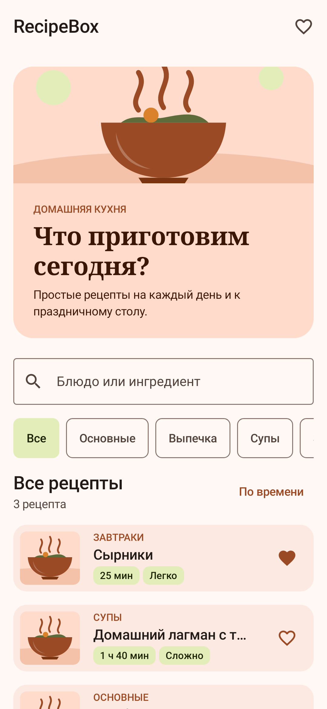
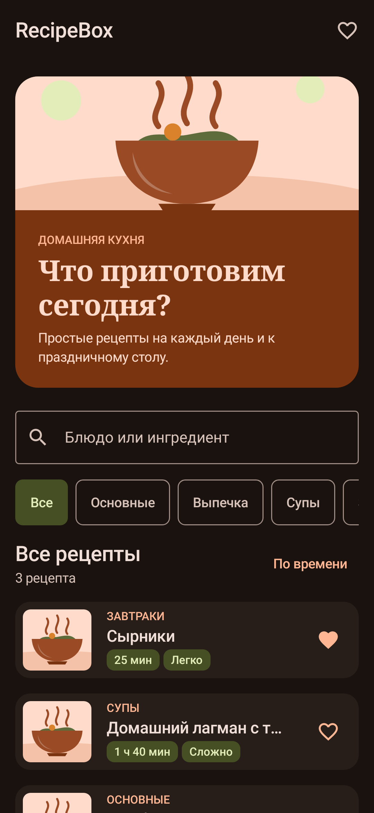
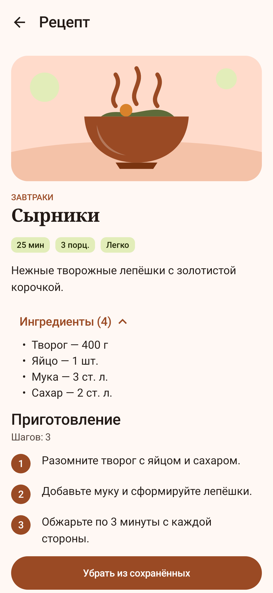
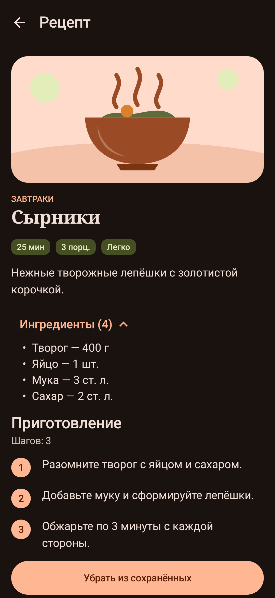
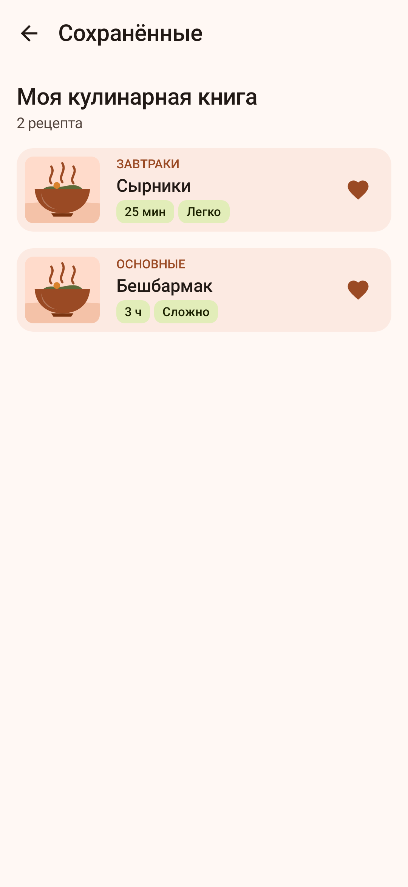
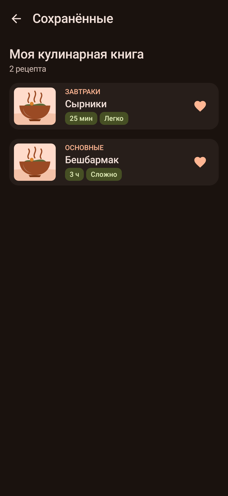
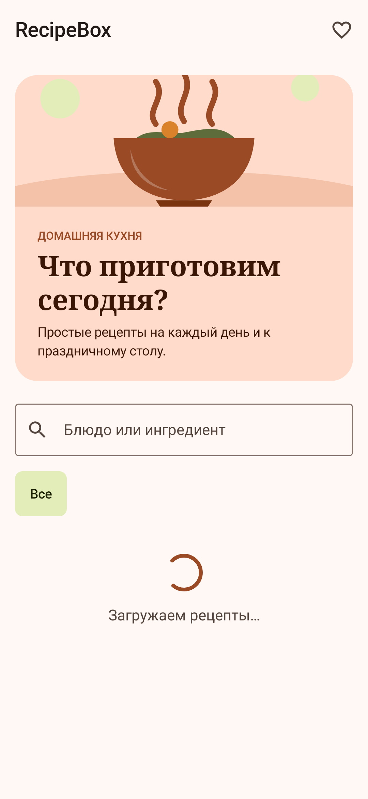
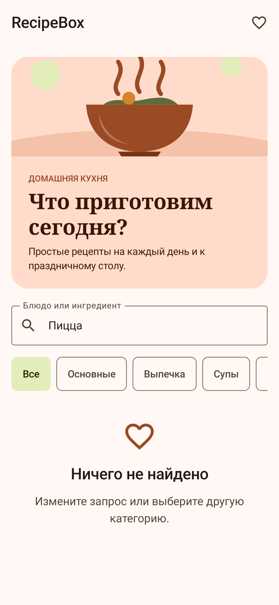
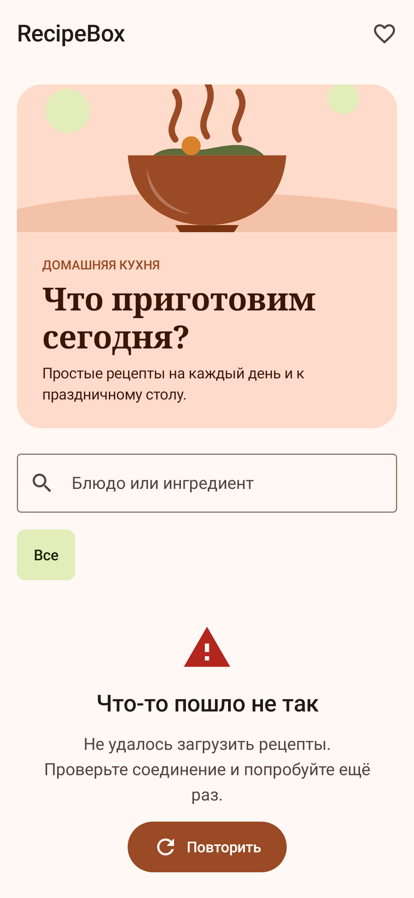
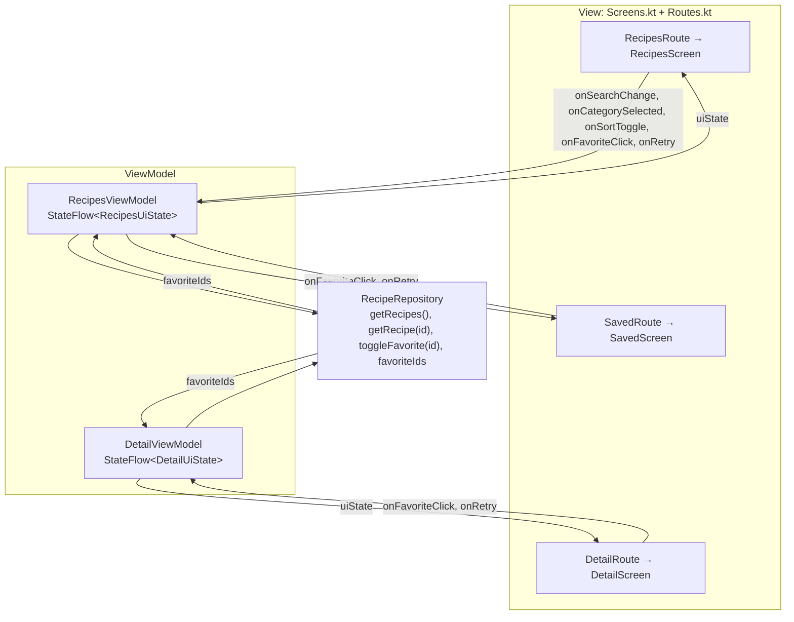

# RecipeBox — SIS 3 / SIS 4

Учебное Android-приложение на **Kotlin + Jetpack Compose + Material 3**: каталог из 12 рецептов с поиском по названию и ингредиентам, фильтром по категориям, сортировкой по времени, экраном рецепта и сохранёнными рецептами. Работает офлайн, без регистрации и разрешений. «Сервер» имитируется в `RecipeRepository` через `delay()`.

## Запуск
1. Установите [Android Studio](https://developer.android.com/studio) **Meerkat (2024.3) или новее**.
2. **Open** → папка проекта (в ней лежат `settings.gradle.kts` и `gradlew`).
3. **Settings → Build Tools → Gradle → Gradle JDK**: встроенный `jbr-21` (подходит JDK 17 или 21).
4. Дождитесь синхронизации Gradle, создайте эмулятор Android API 35 и нажмите ▶ **Run**.

Из терминала: `./gradlew assembleDebug` (APK), `./gradlew testDebugUnitTest` (тесты). Готовый APK после каждого коммита собирает GitHub Actions: вкладка **Actions** → последний запуск → артефакт `RecipeBox-debug`.

Чтобы увидеть состояние ошибки, поставьте `SIMULATE_SERVER_ERROR = true` в `RecipeBoxApp.kt` и запустите приложение заново.

## Скриншоты
Скриншоты рендерит [Paparazzi](https://github.com/cashapp/paparazzi) из настоящих composable-экранов (`ScreenshotTest.kt`) в GitHub Actions; они обновляются автоматически.

| Экран | Светлая тема | Тёмная тема |
|---|---|---|
| Каталог |  |  |
| Рецепт |  |  |
| Сохранённые |  |  |

| Загрузка | Ничего не найдено | Ошибка | Нет сохранённых |
|---|---|---|---|
|  |  |  |  |

## Что внутри
Пути Kotlin указаны относительно `app/src/main/java/kz/student/recipebox/`.

| Файл | Что внутри |
|---|---|
| `MainActivity.kt` | логи жизненного цикла, `RecipesViewModel` на уровне Activity, NavHost и нижняя навигация |
| `RecipeBoxApp.kt` | Application: один общий `RecipeRepository`, флаг `SIMULATE_SERVER_ERROR` |
| `data/Recipe.kt` | `data class Recipe` |
| `data/RecipeRepository.kt` | 12 рецептов, `delay()`, `shouldFail`, сохранённые id в `StateFlow` |
| `data/FavoritesStorage.kt` | сохранение избранного в SharedPreferences |
| `ui/RecipesViewModel.kt` | `RecipesUiState`, события каталога, `prepareRecipes()` — поиск, фильтр, сортировка |
| `ui/DetailViewModel.kt` | `DetailUiState`, id рецепта из `SavedStateHandle` |
| `ui/Routes.kt` | `RecipesRoute`, `SavedRoute`, `DetailRoute` с `collectAsStateWithLifecycle()` |
| `ui/Screens.kt` | экраны без состояния и превью всех состояний |
| `ui/Components.kt` | 9 собственных компонентов: `AppTopBar`, `SectionHeader`, `CategoryChip`, `InfoBadge`, `DishImage`, `RecipeCard`, `EmptyState`, `LoadingState`, `ErrorState` |
| `ui/PreviewData.kt` | фейковые `UiState` для превью и скриншотов |
| `ui/theme/Theme.kt` | светлая и тёмная палитры, типографика, `Spacing` |
| `res/drawable/dish.xml` | собственная векторная иллюстрация блюда |
| `app/src/test/…/RecipesViewModelTest.kt` | 7 unit-тестов ViewModel |
| `app/src/test/…/ScreenshotTest.kt` | рендер экранов в PNG |
| `design/` | размеченные макеты экранов и план архитектуры |

## Требования SIS 3
| Требование | Где |
|---|---|
| 3+ экрана | каталог, рецепт, сохранённые |
| LazyColumn на 10+ элементов | 12 `RecipeCard` в `RecipesScreen` |
| LazyRow | категории в каталоге, бейджи на экране рецепта |
| Scaffold + TopAppBar, кнопка «назад» | `AppTopBar` на всех экранах; «назад» на рецепте и сохранённых |
| Многоточие и пустое состояние | `maxLines` + `TextOverflow.Ellipsis` (лагман с длинным названием), `EmptyState` |
| Image с contentDescription | `DishImage` → `R.drawable.dish` |
| Своя палитра, без цветов и размеров шрифта в экранах | только `Theme.kt` |
| Единые отступы | `Spacing` (4, 8, 16, 24 dp) |
| Тёмная тема | `DarkColors`, скриншоты выше |
| Элементы ≥ 48 dp | `Spacing.touch` у всех кнопок и чипов |
| 3+ переиспользуемых компонента, превью (в том числе тёмные) | `Components.kt`, `Screens.kt` |
| data class + список | `Recipe`, список в `RecipeRepository` |
| Navigation Compose, id как аргумент | `detail/{id}` с `NavType.IntType` |
| `remember` + `mutableStateOf` | раскрытие ингредиентов в `DetailScreen` |
| Бонусы | нижняя навигация, `AnimatedVisibility` |

## От макетов к приложению
Макеты в `design/` — цифровые схемы с подписанными блоками (Scaffold, TopAppBar, LazyColumn, LazyRow, Card, Row, Column, Image, Text). Структура в приложении совпадает: каталог — Card с Image и Column, поиск, LazyRow категорий, RecipeCard (Card → Row → Image + Column); рецепт — изображение, бейджи в LazyRow, раскрываемые ингредиенты, шаги, кнопка сохранения; сохранённые — те же RecipeCard или EmptyState.

Отличия от эскизов: у каждого экрана появились состояния загрузки и ошибки (SIS 4), а кнопка сортировки стала текстовой кнопкой рядом с заголовком.

## Архитектура (SIS 4)

MVVM с однонаправленным потоком данных: события идут вверх к ViewModel, состояние спускается вниз к экрану. План, сделанный до кода, — `design/architecture.md`.



| Слой | Файлы | Ответственность |
|---|---|---|
| Model | `data/RecipeRepository.kt`, `data/FavoritesStorage.kt` | владеет данными, ждёт `delay()`, может бросить ошибку |
| ViewModel | `ui/RecipesViewModel.kt`, `ui/DetailViewModel.kt` | приватный `MutableStateFlow`, публичный `StateFlow`, обновления через `copy()`, поиск/фильтр/сортировка |
| View | `ui/Routes.kt`, `ui/Screens.kt`, `ui/Components.kt` | Route собирает состояние, Screen только рисует `uiState` и вызывает лямбды |

Четыре состояния `RecipesUiState`: загрузка (`isLoading`), ошибка (`error != null`), пусто (`recipes` пустой), контент. Пять действий: поиск, категория, сортировка, сохранение, повтор. Поиск, категория, сортировка и сохранённые рецепты живут во ViewModel и репозитории, поэтому переживают поворот экрана.

### Путь одного клика
Пользователь нажимает категорию «Супы» в `RecipesScreen` (`ui/Screens.kt`). `CategoryChip` вызывает лямбду `onCategorySelected("Супы")`. В `RecipesRoute` (`ui/Routes.kt`) эта лямбда равна `viewModel::onCategorySelected`, поэтому вызывается `RecipesViewModel.onCategorySelected()` (`ui/RecipesViewModel.kt`). Функция выполняет `_uiState.update { it.copy(selectedCategory = category, recipes = prepareRecipes(allRecipes, it.searchQuery, category, it.sortByTime)) }`. `StateFlow` выдаёт новое `RecipesUiState`, `collectAsStateWithLifecycle()` в `RecipesRoute` получает его, Compose перерисовывает `RecipesScreen`, и в списке остаются 3 супа.

### Поворот экрана: Logcat
Фильтр в Logcat: `tag:MainActivity | tag:RecipesViewModel`.

```
TODO: запустите приложение, поверните экран и вставьте сюда реальный вывод Logcat
```

**Почему Activity пересоздалась, а ViewModel нет:**

TODO: объясните своими словами в 3–4 предложениях.

### Бонусы SIS 4
- `DetailViewModel` получает id через `SavedStateHandle`.
- Unit-тесты `RecipesViewModelTest`: загрузка, фильтр, поиск по ингредиенту, пустой результат, сортировка, ошибка, сохранение.
