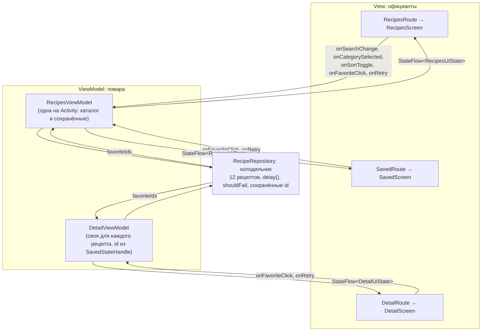

# RecipeBox: план экранов и архитектуры

## Экраны (SIS 3)

| Экран | Файл-эскиз | Структура |
|---|---|---|
| Каталог рецептов | `list-sketch.svg` | Scaffold → TopAppBar → LazyColumn: Card с Image, TextField поиска, LazyRow категорий, Row заголовка с сортировкой, RecipeCard (Card → Row → Image + Column). Внизу NavigationBar |
| Рецепт | `detail-sketch.svg` | Scaffold → TopAppBar с «назад» → LazyColumn: Card с Image, Column с названием, LazyRow бейджей, описание, раскрываемые ингредиенты, шаги, кнопка «Сохранить» |
| Сохранённые | `saved-sketch.svg` | Scaffold → TopAppBar с «назад» → LazyColumn с теми же RecipeCard или пустое состояние (Column: иконка + тексты). Внизу NavigationBar |

## Архитектура MVVM (SIS 4)

Аналогия из лекции: **официант** — экран (View), **повар** — ViewModel, **холодильник** — Repository. События идут вверх, состояние спускается вниз.

### Доска заказов: RecipesUiState

| Поле | Зачем |
|---|---|
| `isLoading` | идёт загрузка |
| `error` | текст ошибки, `null` если всё хорошо |
| `searchQuery` | текст в поиске |
| `selectedCategory` | выбранная категория |
| `categories` | список категорий для LazyRow |
| `sortByTime` | сортировать ли по времени приготовления |
| `recipes` | готовый отфильтрованный и отсортированный список |
| `favoriteIds` | id сохранённых рецептов |
| `favorites` | рецепты для экрана «Сохранённые» |

Четыре ситуации: загрузка, ошибка, пусто (`recipes` пустой), контент.

**DetailUiState**: `isLoading`, `error`, `recipe` (`null` после загрузки — «не найден»), `isFavorite`.

### События

| Событие | ViewModel | Что делает |
|---|---|---|
| `onSearchChange(query)` | RecipesViewModel | сохраняет текст и пересчитывает список |
| `onCategorySelected(category)` | RecipesViewModel | меняет категорию и пересчитывает список |
| `onSortToggle()` | RecipesViewModel | включает или выключает сортировку по времени |
| `onFavoriteClick(id)` | обе | сохраняет или убирает рецепт через репозиторий |
| `onRetry()` | обе | повторяет загрузку после ошибки |

### Холодильник

`RecipeRepository` — единственный владелец данных. Он ждёт `delay()`, как сервер, бросает `IOException` при `shouldFail = true` и хранит сохранённые id в `StateFlow`, записывая их в SharedPreferences.

### Путь одного клика

Пользователь нажимает категорию «Супы». `CategoryChip` вызывает `onCategorySelected("Супы")`, которую `RecipesScreen` получил параметром. В `RecipesRoute` эта лямбда — `viewModel::onCategorySelected`, поэтому вызывается `RecipesViewModel.onCategorySelected()`. Она делает `_uiState.update { it.copy(selectedCategory = "Супы", recipes = prepareRecipes(...)) }`. `StateFlow` выдаёт новое состояние, `collectAsStateWithLifecycle()` в `RecipesRoute` его получает, и Compose перерисовывает список: остаются только супы.
